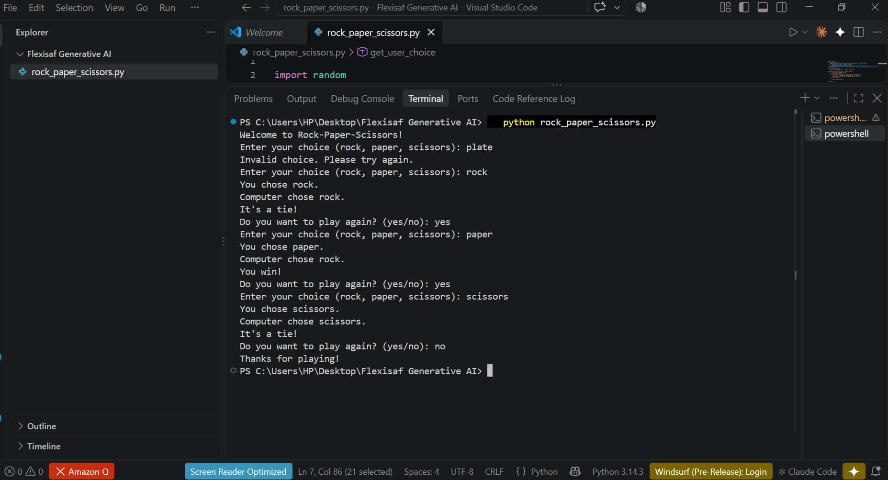

# Rock Paper Scissors

A command-line Rock Paper Scissors game in Python where you play against the computer.

## Features
- Defines the possible choices (rock, paper, scissors)
- Gets and validates the user's choice
- Generates a random computer choice
- Determines the winner using the standard rules
- Play-again loop

## Requirements
- Python 3.8 or higher
- No external libraries (uses the built-in `random` module)

## How to Run
```
python rock_paper_scissors.py
```
Type `rock`, `paper` or `scissors` when prompted. After each round, type `yes` to play again or anything else to quit.

## Rules
- Rock beats scissors
- Scissors beats paper
- Paper beats rock
- Same choice is a tie

## Sample Output


## Files
- `rock_paper_scissors.py`: the program
- `screenshot.png`: evidence of a test run

## Author
Jess ([github.com/Jessicaayegh](https://github.com/Jessicaayegh))