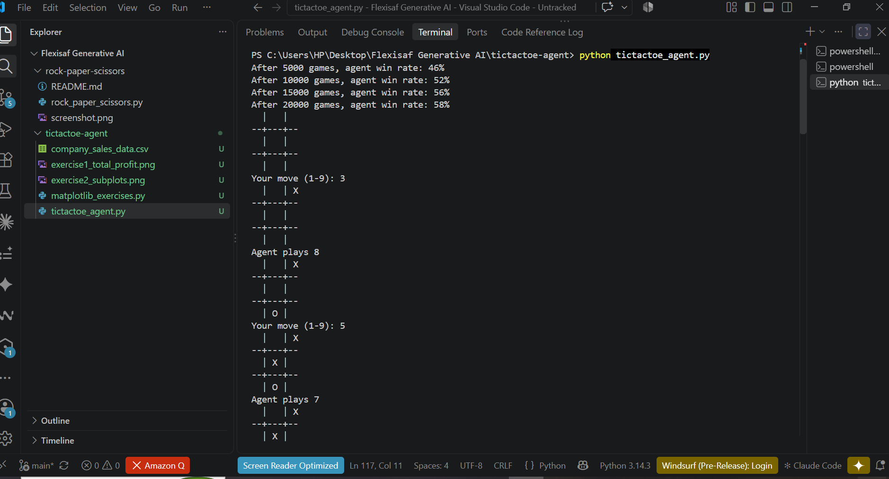
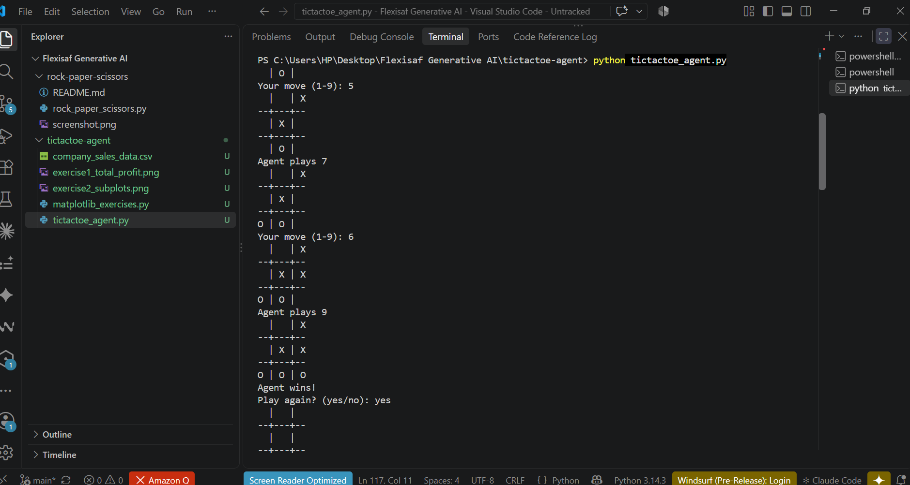
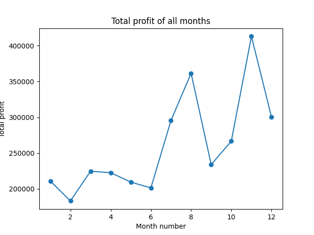
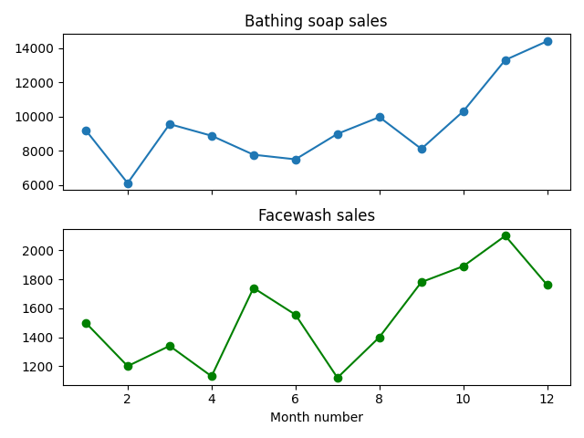

# Tic-Tac-Toe Learning Agent and Matplotlib Exercises

Two Python deliverables for the Python Programming for AI stage of the FIP internship.

## Task 1: Tic-Tac-Toe Learning Agent

A command-line tic-tac-toe game where an AI agent learns to play by reinforcement learning. The agent trains by playing 20,000 games against a random opponent, then plays against you.

### How it works
- Keeps a score for every (board state, move) pair
- Wins raise the scores of the moves that led to them, losses lower them
- Explores random moves 20% of the time during training, and always picks its best-known move when playing you

### Program structure (`tictactoe_agent.py`)
- `create_board()` and `print_board()`: define and display the game board
- `check_winner()`: checks if a player has won
- `check_tie()`: checks if the game is a tie
- `LearningAgent`: chooses moves and learns from results
- `train()`: trains the agent and prints its win rate
- `main()`: the main game loop, called at the bottom of the file

### How to run
```
python tictactoe_agent.py
```
The agent trains first and prints its win rate every 5,000 games. You then play as X against the agent (O) by entering a number from 1 to 9.

### Evidence



## Task 2: Matplotlib Exercises

Uses `company_sales_data.csv` (from https://pynative.com/wp-content/uploads/2019/01/company_sales_data.csv). A local copy is included because the website blocks automated downloads.

- **Exercise 1:** total profit of all months, shown as a line plot
- **Exercise 2:** bathing soap and facewash sales for all months, shown using subplots

### How to run
```
pip install matplotlib pandas
python matplotlib_exercises.py
```
Close the first plot window to see the second.

### Evidence



## Requirements
- Python 3.8 or higher
- Task 2 needs `matplotlib` and `pandas`

## Files
- `tictactoe_agent.py`: Task 1 program
- `matplotlib_exercises.py`: Task 2 program
- `company_sales_data.csv`: dataset for Task 2
- `tictactoe_training.png`, `tictactoe_output.png`: Task 1 evidence
- `exercise1_total_profit.png`, `exercise2_subplots.png`: Task 2 evidence

## Author
Jess ([github.com/Jessicaayegh](https://github.com/Jessicaayegh))